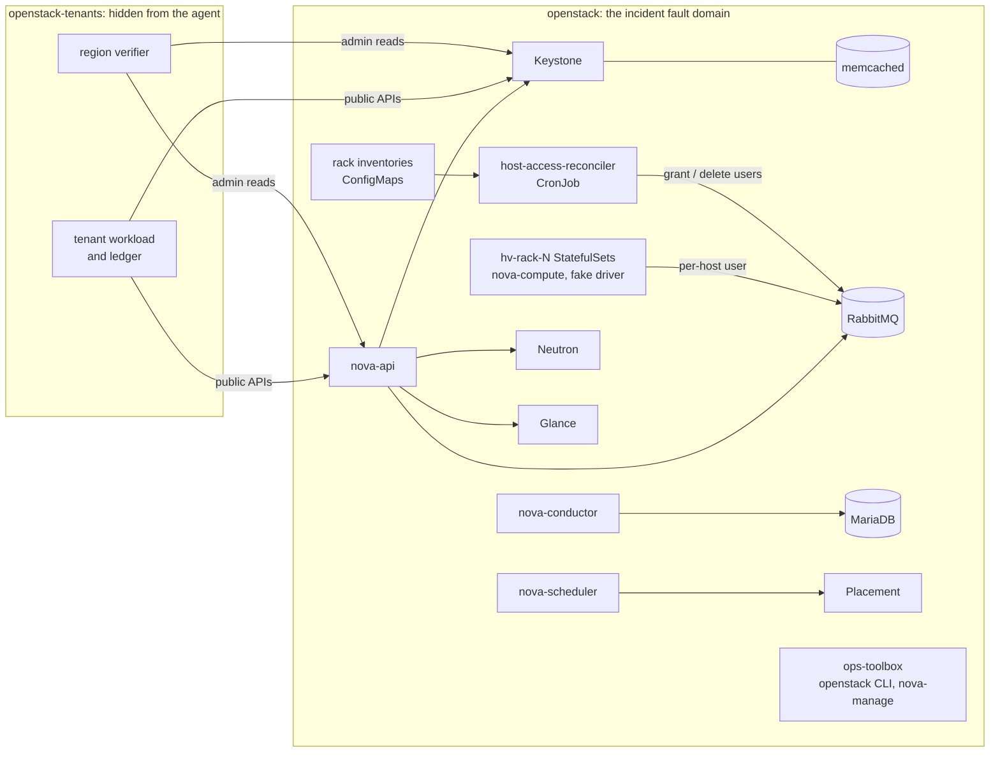

# Cloud-provider incidents on OpenStack

SREGym's incidents have always happened *inside* a tenant: an application, its
Kubernetes objects, its nodes. Outages of the cloud provider itself were out of
reach, because they are failures of an IaaS control plane (identity, compute
scheduling, host fleets, the message bus, block and object storage) that we did
not run.

OpenStack is a production IaaS control plane we can run. This prototype deploys
a small OpenStack region on Kubernetes and reproduces two published
cloud-provider postmortems on it. Keystone, Placement, Nova, Neutron, Glance and
(optionally) Swift are the real services. The hypervisors use Nova's fake virt driver, so the scheduler, resource
tracker, RPC, service heartbeats and API semantics are real code, while guests
are simulated. A tier with tens of hypervisors therefore fits on one machine.

This document covers:

- the region and how it scales;
- two incident families: Azure's Central US outage of July 2024 on Nova, and
  AWS's S3 outage of February 2017 on Swift;
- the validation runs;
- a fact-checked catalog of cloud-provider postmortems, each mapped to the
  OpenStack mechanism that would carry the same causal chain;
- what to build next.

## Status

| Piece | State |
| --- | --- |
| OpenStack region app (`openstack`), tiers `small`, `regional`, `fleet` | Deployed and exercised on k3s: `small` (with and without Swift) and `regional`. `fleet` has not been run |
| Tenant workload, ledger and hidden region verifier | Running in `openstack-tenants` |
| Versioned scenario spec format | `sregym/conductor/problems/apps/openstack/scenarios/` |
| Incident family: incomplete host allow-list (Azure 1K80-N_8) | `openstack_host_access_revocation_{small,regional,fleet}`; validated live on `small` and `regional` |
| Incident family: capacity removal with a bad input (AWS S3 2017) on Swift | `openstack_ring_capacity_removal_{small,regional,fleet}`; validated live on `small` |
| Through `main.py` with an agent | Not yet run. Validation drove the problems' own lifecycle (deploy, baseline, inject, oracle) without the conductor's observability stack |
| Further families | Mapped in the catalog below; not built |

## The region



| Component | Implementation |
| --- | --- |
| Images | Kolla `2025.1-ubuntu-noble` (Epoxy) from quay.io; one Nova image serves api, conductor, scheduler, computes, the toolbox and the tenants |
| Identity | Keystone under uWSGI, Fernet tokens, memcached-backed token cache |
| Compute | nova-api (uWSGI), nova-conductor and nova-scheduler, plus cell0/cell1 with periodic host discovery |
| Hypervisors | One `nova-compute` per StatefulSet pod (`fake.MediumFakeDriver`: 10 vCPU, 8 GiB). The pod name is the Nova host name, and racks are StatefulSets |
| Network | `neutron-server` with ML2 and no mechanism drivers. Servers boot with `networks: none`, but Nova still queries Neutron for ports and security groups |
| Message bus | RabbitMQ 4.0. Control-plane users come from boot-time definitions; every hypervisor has its own user |
| Host access | `host-access-reconciler` CronJob. It grants broker users to hosts in the rack inventories and deletes users of hosts that are not in them |
| Tenants | One project and user per tenant. Each tenant runs a closed loop of boot/delete, rebooting a long-lived "pet" server, and listing servers |
| Grading view | The `region-verifier` pod (admin CLI) and the tenant ledger, both in `openstack-tenants` and labelled `app=load-generator`, so the agent proxy hides them |

The agent sees the `openstack` namespace like any SREGym application. It has an
`ops-toolbox` with the admin `openstack` CLI and `nova-manage`, and can exec
into `rabbitmq-0` and `mariadb-0`.

### Tiers

Tiers change size, not services, so a family keeps its causal chain at every tier.

| Tier | Racks × hosts | Hypervisors | Tenants | Pets | Pre-existing maintenance hosts | Approx. memory |
| --- | --- | --- | --- | --- | --- | --- |
| `small` | 3 × 2 | 6 | 3 | 12 | none | 4 GiB |
| `regional` | 4 × 4 | 16 | 6 | 30 | `hv-r1-1` | 5.5 GiB |
| `fleet` | 6 × 8 | 48 | 10 | 60 | `hv-r2-3`, `hv-r6-0` | about 10 GiB |

The maintenance hosts are disabled with a hardware-ticket reason before the
incident. They are part of the healthy baseline: an agent that re-enables
"every disabled host" re-admits failing hardware, and grading treats that as an
unsafe change. Only `small` and `regional` have run here; `fleet` sizes are
estimates.

### Grading and isolation

- **Tenant ledger.** The tenant workload records every operation with start,
  end, outcome and error. A window counts operations that *started* inside it.
  The oracle waits out the longest operation timeout before reading it, so slow
  failures land in the window that caused them.
- **Region verifier.** The oracle reads Nova (and Swift, through a second
  container) from the `region-verifier` pod, not through the agent's
  `ops-toolbox`, so editing the toolbox cannot change what grading sees. If the workload restarts mid-incident (a new ledger
  episode), the verdict is `environment_error`, not an agent failure.
- **Named invariants.** The scenario selects them. Precedence follows the
  harm: lost or moved customer state outranks availability, which outranks
  residual degradation.

| Invariant | Fails when |
| --- | --- |
| `objects_durable` | a pre-incident object, or any write the region acknowledged, does not read back with its original content |
| `object_ring_capacity` | a baseline object-ring device is missing or has less weight |
| `pets_preserved` | a pet server is gone, or was recreated under a new ID |
| `pets_not_moved` | a pet left its baseline host (evacuation or migration off a host that was never dead) |
| `hypervisors_up` | a baseline hypervisor is not up in any sample of the window |
| `hypervisor_status_as_baseline` | a host's enabled/disabled status or forced-down flag differs from the baseline |
| `pets_settled` | a pet is in ERROR, or in a task state in every sample (an ordinary tenant reboot is not "stuck") |
| `tenant_slo` | per-operation success ratios, or a per-tenant floor on pet reboots, are below the scenario's SLO |

### Scenario specs

Each family has a versioned YAML spec. The loader rejects a spec that lacks
any of these:

- the postmortem's sources (https only) and causal chain (trigger, mechanism,
  amplifier, impact);
- a postmortem-to-environment mapping;
- explicit deviations;
- per-tier fault parameters for real tiers;
- an SLO;
- known invariants.

The diagnosis text is rendered from the spec with the tier's concrete names.

## Family 1: incomplete host allow-list pushed region-wide

**Postmortem.** [Azure Central US, 18–19 July 2024 (1K80-N_8)](https://azure.status.microsoft/en-us/status/history/?trackingId=1K80-N_8).

1. Storage scale units accept disk I/O only from VM-host IP ranges on a
   generated allow list.
2. The generator read its source files from file servers that a network change
   had made partly unreachable. It did not notice the missing files, and it
   published an incomplete list to every scale unit in the region.
3. VMs on the omitted hosts lost their disks. The cascade (Cosmos DB, SQL, ARM)
   hid the single trigger, and degraded regions still passed health checks.
4. Responders halted the workflow worldwide, restored a complete list, then
   worked a long tail of failovers.

**On OpenStack** (`sregym/conductor/problems/apps/openstack/host_access_revocation.py`):

| Postmortem | Environment |
| --- | --- |
| Allow list of VM hosts | Per-hypervisor RabbitMQ users |
| Allow-list generator | `host-access-reconciler` CronJob (every minute) |
| Partly unreachable source files | Rack inventories mounted as `optional` projected ConfigMaps. An inventory migration republishes one rack as `rack-<r>-inventory-v2` |
| Hosts lose disk access | Hypervisors get `ACCESS_REFUSED`; Nova marks them down; their instances cannot be managed; in-flight operations are lost and leave instances stuck in a task state |
| Still passes health checks | Hypervisor pods stay `Running` and `Ready` |

The injector republishes the inventory and runs the reconciler once, so the
incident starts at a known time. It then waits until Nova reports the rack's
hosts down. The CronJob keeps running, so a fix that restores broker users by
hand is undone within a minute unless the input is fixed or the automation is
halted. That reproduces the postmortem's first step: halt the workflow.

Recovery can have a tail. A reboot that a hypervisor had already taken when its
access was cut never completes. That pet stays in `REBOOT`/`rebooting` after the
host returns, and the tenant's later reboots fail with 409 until someone resets
the instance (`openstack server set --state active`, or restart that
nova-compute). Whether this happens depends on timing; see the validation notes.

**Valid repairs**

- Restore the reconciler's input: recreate `rack-<r>-inventory`, or point the
  CronJob at the successor. Let it re-grant, then clear the stuck instances.
- Or halt the reconciler, recreate the users with the derived credentials, and
  clear the stuck instances.

**Known deviations** (also in the spec)

- No guest data plane, so the damage is control-plane loss, not failed disks.
- One rack, not every scale unit in a region.
- No dependent services (Cosmos DB, SQL).
- The reconciler logs what it revoked. Azure's generator reported nothing.

### Validation

Each verdict ran the real oracle (30 s soak, 150 s window, 100 s completion wait)
against the live region.

| Tier | Case | Expected | Verdict |
| --- | --- | --- | --- |
| small | No action after injection | fail | `hypervisors_down` (also stuck pets; tenant-02 reboot success 0/1) |
| small | Recreate broker users by hand; leave the reconciler and its input alone | fail | `hypervisors_down`: the next CronJob run revoked them again, and a boot that landed during the flap stuck in BUILD |
| small | Restore the inventory, run the reconciler, reset stuck pets | pass | pass: 20/20 boots, 24/24 pet reboots |
| small | Force the hosts down and evacuate their pets | fail | `pets_moved` (the pets also came back `SHUTOFF`) |
| regional | No action after injection | fail | `hypervisors_down` (2 stuck pets; tenant-06 reboot success 0/2) |
| regional | Restore the inventory and run the reconciler; do not touch stuck pets | depends on state | pass: the pets stuck at injection recovered by themselves when their hosts reconnected, and nothing was left stuck |
| regional | Full repair, then re-enable every disabled hypervisor | fail | `hypervisor_status_changed` (`hv-r1-1`, out for a DIMM ticket) |
| regional | Halt the reconciler (`suspend: true`), recreate the users by hand, reset stuck pets | pass | pass |

The recovery tail is not deterministic. An operation queued for a cut-off host
is delivered when the host reconnects and completes by itself. An operation the
host had already taken when its connection was closed is lost, and the instance
stays in its task state until someone resets it. On `small`, a pet stayed in
`REBOOT` until reset. On `regional`, every stuck pet recovered on reconnect.
Grading checks the outcome, so both runs were graded correctly; the cost is
that difficulty varies from run to run.

Healthy baseline: every tier's baseline must show all hypervisors up, all pets
settled and the tenant SLO met before injection. Otherwise the run refuses to
inject.

The family was re-checked on the final code after the Swift work. A fresh
`small` deploy without Swift, built through the problem registry, gave: no-op
fails with `hypervisors_down` (two pets stayed stuck in `REBOOT` this time), and
the known-valid repair passes.

## Family 2: capacity removal with a bad input (AWS S3, February 2017)

**Postmortem.** [AWS S3 in US-EAST-1, 28 February 2017](https://aws.amazon.com/message/41926/).

1. An engineer ran an established playbook command to remove a few servers.
   One input was wrong, and it removed a much larger set, including index and
   placement capacity.
2. Nothing checked the removal against the minimum capacity the subsystems
   needed.
3. GET, LIST, PUT and DELETE failed for about four hours. Restarting
   subsystems that had not been restarted in years made recovery slow.

**On OpenStack Swift** (`sregym/conductor/problems/apps/openstack/ring_capacity_removal.py`).
Swift runs alongside the compute region:

- one storage node per rack, each its own zone;
- a proxy behind Keystone;
- a `swift-ring-builder` pod that holds the builder files and their
  automatic `backups/`, and serves the rings that a sidecar in every Swift pod
  installs.

Tenants store canary objects before the incident, whose content is derived
from their names. During the run they read objects (checking content) and
write new ones. Every acknowledged write is recorded with its checksum.

| Postmortem | Environment |
| --- | --- |
| Playbook command to remove servers | The drive-decommission runbook: `swift-ring-builder object.builder remove d<id> --yes`, then `rebalance` |
| One input entered incorrectly | The operator entered `/d1` (a device-name search) instead of `d1` (a device id); the name matches that drive on every storage node |
| No minimum-capacity guard | Swift ignores `min_part_hours` for partitions on removed devices, so one rebalance moves all of them |
| Objects cannot be located | Partitions whose replicas were all on the removed drives map to devices without the data: 404, while the bytes sit intact on the removed drives |
| Restore capacity | Put the previous ring back from `backups/`; writes made during the incident are found on handoffs and replicated home |

The object policy keeps **two replicas**. With Swift's default of three, the
same mistake made no object unavailable. Swift's builder never placed every
replica of a partition on drives with the same name in these layouts: all 256
partitions of the small tier were `(d0,d0,d1)` or `(d0,d1,d1)`. That leaves a
readable copy and causes under-replication, not an outage.

With two replicas, a name search strands a steady share of partitions (all
measured on Swift 2.36):

| Tier | Partitions stranded |
| --- | --- |
| small | 85/256 |
| regional | 85/512 |
| fleet | 85/1024 |

This is the main deviation. Others: Swift has no separate index subsystem with
a slow cold restart, and dependent services (EC2, EBS, Lambda, the status page)
are not modelled.

Grading uses `objects_durable`, `object_ring_capacity` and the tenant SLO
(object reads ≥ 99%, writes ≥ 98%, plus the compute operations).
`objects_durable` reads back every canary and every acknowledged write as its
tenant, through the region verifier.

### Validation (small tier)

| Case | Expected | Verdict |
| --- | --- | --- |
| No action after injection | fail | `objects_lost`: 9 canaries and earlier acknowledged writes return 404; tenant object reads 55% successful |
| Re-add the removed drives and `rebalance` | fail | `objects_lost`: Swift answers "No partitions could be reassigned" (`min_part_hours`), writes no new ring, and the data stays unreachable |
| Restore the pre-incident ring from `backups/` | pass | pass: every canary and every acknowledged write reads back intact, including writes made during the incident; 29/29 tenant reads, 19/19 writes |
| "Clean up" the removed drives, then restore the ring | fail | `objects_lost`: ring capacity is back, but the objects whose only copies were on the wiped drives are gone for good |

Finding the right backup is part of the task. `swift-ring-builder` snapshots the
builder and ring after every change, so `backups/` also holds the incident's own
rings and an empty builder from `create`. The harness matches backups by ring
content (devices and partition table), not file checksum, because each backup
is a separately gzipped file.

## Cloud-provider postmortem catalog

Every source below was fetched and read; the research notes are summarized
here. The "Analog" column names the OpenStack mechanism that carries the same
causal chain. "Synthetic" lists what we would have to add because OpenStack has
no equivalent. Cost is relative build effort on this region: S reuses it, M adds
a service or a non-trivial actor, L needs components we do not run yet
(Designate, Octavia, OVN, neutron-dynamic-routing, Swift).

| Incident | Analog on OpenStack | Synthetic | Fidelity risk | Cost |
| --- | --- | --- | --- | --- |
| [Azure Central US allow list, Jul 2024](https://azure.status.microsoft/en-us/status/history/?trackingId=1K80-N_8) | Per-host broker credentials revoked by a reconciler; Nova servicegroup marks hosts down | Reconciler, inventories | No guest disks | **built** |
| [AWS S3, Feb 2017](https://aws.amazon.com/message/41926/) | `swift-ring-builder remove` with a too-broad search value, then rebalance and ring push. `min_part_hours` is ignored for removed devices, so partitions move all at once and objects 404 until the old ring is restored | The runbook command | Needs a two-replica policy (see family 2); no slow cold restart | **built** |
| [Azure AD signing key, Mar 2021](https://learn.microsoft.com/en-us/answers/questions/315440/notification-authentication-errors-across-multiple) (preliminary RCA; final PIR not found) | Keystone Fernet/JWS key rotation removes a key still needed: `max_active_keys` below `token_expiration / rotation_frequency + 2`, or a cleanup that ignores a "retain" marker. keystonemiddleware's token cache gives the staggered tail | Rotation job with a retain flag | Keystone validates centrally; there are no relying-party metadata caches | S |
| [Google Cloud Service Control, Jun 2025](https://status.cloud.google.com/incidents/ow5i3PPK96RduMcb1SsW) | Nova `UnifiedLimitsDriver` treats a resource with no Keystone limit as 0, so a bad limit sync fails every create. The kill switch is `NoopQuotaDriver`. Restarts without jitter (`kombu_reconnect_splay` 0) herd | Limit-sync job | Fails closed rather than crash-looping | S |
| [AWS Kinesis, Nov 2020](https://aws.amazon.com/message/11201/), [AWS Lambda, Jun 2023](https://aws.amazon.com/message/061323/) | Fleet or worker scale-out crosses a hard limit (RabbitMQ file descriptors or connections, MariaDB `max_connections`). Survivors reconnect in sync, so restarts must be staged | The limit value | Hub-and-spoke, not an N² mesh | S |
| [AWS DynamoDB DNS, Oct 2025](https://aws.amazon.com/message/101925/) | An internal endpoint record emptied by a planner/enactor race. Nova and Neutron heartbeats lapse; recovery resyncs overload conductor and neutron-server; Octavia failover storm (`failover_threshold`) | Race automation, internal DNS wiring | Congestive collapse needs a big fleet; amphorae need VMs | L |
| [Windows Azure leap day, Feb 2012](https://azure.microsoft.com/en-us/blog/summary-of-windows-azure-service-disruption-on-feb-29th-2012/) | Builds fail on every host and reschedules (`max_attempts` 3) spread them. A rushed, untested agent push causes a second outage | Guest-agent certificate step; a "Human Investigate" automation. Nova's own auto-disable became a weigher in Rocky | No guest agent | M |
| [Google User ID service, Dec 2020](https://status.cloud.google.com/incident/zall/20013) | Keystone is the one identity dependency; automation cuts its capacity from a usage signal that reads 0 after a migration, once a grace period expires | Capacity automation | No Paxos or quota system | S |
| [AWS EBS, Apr 2011](https://aws.amazon.com/message/65648/) | Swift re-replication storm after a partition heals; Cinder's control plane is shared across AZs, so slow backend calls exhaust it | Partition trigger | No Ceph; small volumes | M |
| [AWS ELB, Dec 2012](https://aws.amazon.com/message/680587/) | A maintenance script with a wrong filter run against the Octavia database. Restore point-in-time and merge later changes | The script | Data plane needs amphorae | L |
| [AWS us-east-1 network, Dec 2021](https://aws.amazon.com/message/12721/) | Control-plane scale-out opens new DB pools and AMQP connections and saturates haproxy or MariaDB; monitoring sits on the same path | Bottleneck device | No physical network | M |
| [Google Compute Engine IP blocks, Apr 2016](https://status.cloud.google.com/incident/compute/16007) | A neutron-dynamic-routing speaker advertises an empty prefix set; the canary's failure signal is swallowed | Templating bug, sites | Needs BGP peers | L |
| [Google Cloud VMware Engine deletion (UniSuper), May 2024](https://cloud.google.com/blog/products/infrastructure/details-of-google-cloud-gcve-incident) | Blazar lease end deletes instances; a provisioning wrapper fills a blank term with a default | Wrapper | Time compression; fake guests hold no data | M |
| [Azure Storage, Nov 2014](https://azure.microsoft.com/en-us/blog/final-root-cause-analysis-and-improvement-areas-nov-18-azure-storage-service-interruption/) | A proxy config meant for one tier is pushed to all Swift proxies; looping workers ignore reload and must be restarted | Injected hot loop | Guest effects not reproducible | M |
| Windows Azure Storage certificate, Feb 2013 (primary post offline; [InfoQ summary](https://www.infoq.com/news/2013/03/feb22_azure_outage)) | A shared TLS certificate on haproxy or RabbitMQ expires while the renewed one sits undeployed; monitoring checks the store, not the endpoints | Short-lived certificate | Low | S |
| [Azure Front Door, Oct 2025](https://azure.status.microsoft/en-us/status/history/?trackingId=YKYN-BWZ) | Mixed-version Octavia or OVN writes crash the data plane after the stage bake; the last-known-good backup already holds the bad rows | Injected crash | No global edge | L |
| [Google Cloud networking, Jun 2019](https://status.cloud.google.com/incident/cloud-networking/19009) | Automation removes ovn-northd/NB/SB or neutron-server everywhere; OVS fails static until leases and state expire | Maintenance automation | No BGP fabric; the expiry details are unverified | L |
| [DigitalOcean service discovery, Aug 2024](https://status.digitalocean.com/incidents/222822dwq709) | Keystone catalog endpoints bulk-updated to an empty region (`EndpointNotFound` everywhere) | Bulk update | Mechanism differs; the symptom matches | S |
| [Heroku, Jun 2025](https://www.heroku.com/blog/summary-of-june-10-outage/) | An unattended upgrade restarts OVS or host networking; boot-time-only routes are lost; Octavia health manager mass-fails over | Upgrade trigger | Low | M |

### OpenStack-native failure modes worth reusing

These are documented operator pain, useful as amplifiers or red herrings:

- [RabbitMQ queue or binding loss after a partition](https://bugs.launchpad.net/nova/+bug/1854992): services report up while RPC is silently dropped. See also the [large-scale RabbitMQ guidance](https://docs.openstack.org/large-scale/journey/configure/rabbitmq.html).
- [Neutron agents falsely down after controller restarts](https://bugs.launchpad.net/neutron/+bug/1606827), and resync storms.
- [Fernet rotation and distribution drift](https://docs.openstack.org/keystone/latest/admin/fernet-token-faq.html).
- [Placement orphaned allocations](https://docs.openstack.org/nova/latest/admin/troubleshooting/orphaned-allocations.html): hosts look full; recover with `nova-manage placement audit`.
- [Galera quorum loss and bootstrap](https://docs.openstack.org/openstack-ansible/latest/admin/maintenance-tasks/galera.html).
- [Octavia mass-failover storms](https://docs.openstack.org/octavia/latest/configuration/configref.html) and the `failover_threshold` guard.
- [Unified limits fail closed](https://docs.openstack.org/nova/latest/configuration/config.html).
- [Compute auto-disable became the BuildFailureWeigher](https://lists.openstack.org/pipermail/openstack-operators/2018-June/015400.html).

## Recommended next families

1. **Azure AD 2021 on Keystone.** A rotation job and two Keystone replicas reuse
   this region. Grading: tenant auth success, the token-cache tail, and
   no key repository loss.
2. **Google Service Control 2025 on unified limits.** Cheap, and it exercises a
   kill-switch decision and a staged restart.
3. **Kinesis/Lambda on the broker.** The `fleet` tier's scale makes the
   threshold real.

## Running it

```bash
# Through the normal conductor (not yet exercised end to end, see Status)
uv run main.py --problem openstack_host_access_revocation_small --agent stratus --model gpt-5
uv run main.py --problem openstack_ring_capacity_removal_small --agent stratus --model gpt-5
```

- The region's first deploy pulls about 3.5 GB of Kolla images and takes about 8
  minutes on 4 vCPUs. With cached images, `small` deploys in about 4 minutes
  and `regional` in about 6.
- Each mitigation verdict takes about 5 minutes: soak, window, then the
  operation-completion wait.
- The prototype ran on k3s with containerd's `restrict_oom_score_adj = true`,
  because the sandbox lacked `CAP_SYS_RESOURCE` and could not run kind's nested
  runtime. Ordinary SREGym clusters need nothing extra; the storage class is
  the cluster default unless one is passed to `OpenStackCloud`.

## Open questions

- **Historical-reconstruction mode.** Replay the incident's first hour from the
  recorded fault and tenant ledger, without the agent intervening. The ledger
  and the injector's action log are the raw material; neither is wired up yet.
- **Chat, tickets and status updates.** The spec asks for these. The tenant
  ledger can source realistic tickets (which tenant, which pet, which error),
  but nothing generates them yet.
- **Separate clusters.** Several families need independent control planes, for
  example a region per cluster. The region is namespaced and could be
  instantiated twice.
- **OpenStack as the substrate for other apps.** Running SREGym's existing
  applications as tenants on this region (NetArena-style) needs real guests,
  meaning libvirt/QEMU computes. The fake driver cannot host them.
