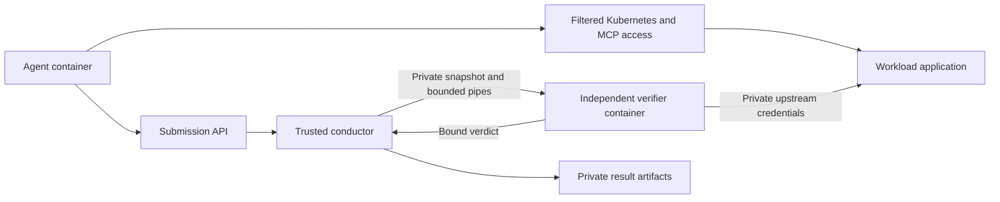

# Independent verifier execution

Diagnosis and mitigation run in a runner-owned verifier container. The conductor
keeps orchestration and model/workload IO; the verifier owns scoring code, expected
answers, preserved baseline state and verdict construction. Native submissions
and the standalone oracle CLI use the same runtime, with no host-grading fallback.



## Run lifecycle

1. Resolve and pin the trusted verifier image and materialize its private
   Kubernetes configuration before baseline capture or fault injection. Build
   time does not consume the agent's repair budget.
2. Capture the deployed application's healthy baseline on its existing oracle.
   Fault injection and agent execution follow that capture.
3. Snapshot the live oracle for each accepted submission. Diagnosis answers pass
   as arguments; mitigation uses live application checks and the saved baseline.
   Task-owned traffic that requires draining is stopped on its actual owner
   before mitigation serialization. Diagnosis does not perform that drain.
4. Run with a non-root verifier UID, a read-only root filesystem, dropped
   capabilities, no-new-privileges, bounded CPU/memory/PIDs and private tmpfs.
   Input, model/workload requests and verdict frames use bounded private pipes.
5. Validate invocation binding, frame structure and boolean success. A worker
   crash, invalid frame, deadline or missing connection becomes a harness failure.
   Oracle-declared failure classes remain intact. No failure invokes host grading.
6. Cancel the attempt's runtime during cleanup or abort. A new attempt receives
   a fresh owner after the previous evaluation and cleanup drain.

## Sources, credentials and agent visibility

Verifier builds accept allowlisted tracked source and dependency files. A
Git-less DinD runtime uses the build-generated SHA-256 source manifest; missing
or changed packaged files fail validation. The DinD launcher supplies this
`verifier_sources` named BuildKit context and removes its temporary directory
after the build.

Default agent images and overlays use a separate public runtime context. It
excludes conductor/oracle sources, private judge bridges, credentials, snapshots
and grading logs. An installer command is constructed after public-runtime
preparation so it uses the selected image's actual runtime path. Custom images
retain their compatibility path and require independent visibility qualification.

Private control service accounts, pods, secrets and probe namespaces are filtered
from reads and writes. Workloads cannot select trusted service accounts or bypass
the proxy through control-pod exec. Existing trusted node helpers use a reserved
maintenance namespace, a private marker, unique owned pod names and owner-specific
cleanup. Agent requests cannot exec, attach, read, mutate, relabel or delete these
resources, including collection deletes. Ordinary workload repairs remain allowed.

The submission API exposes acceptance and stage information, not expected answers,
baselines, grading details or internal exceptions. Private logs retain diagnostic
errors. Existing monotonic time budgets and remaining-budget API are preserved.

## Shared-host deployment boundary

A container alone does not protect private code from an agent that has the
trusted Docker socket, runner filesystem, conductor UID or unrestricted authority
over that host. Those routes must be absent from a qualified deployment.

The opt-in rootless workload engine uses a separate Linux identity and daemon for
workload nodes and agent containers. The trusted verifier uses an independently
selected engine and private credentials. Protected mode rejects host-agent
registrations and unsafe workload privilege settings, including when internet
access is open. The workload engine may retain node repair authority inside its
own boundary; it must not expose the trusted runner's daemon or files.

Rootless is opt-in until the affected catalog and deployment are qualified.
Legacy/native execution still uses independent grading, but must not be described
as satisfying the stronger shared-host boundary without its own access audit.
Existing published image layers, OCI metadata and registry references still need
maintainer migration before the agent-visible identity issue can be closed.

## Standalone snapshots

Use `save_oracle_snapshot` on the owning runner to save an oracle with its
pre-fault baseline. It drains task-owned mitigation state before serialization and
creates the destination exclusively with private permissions. Live host workload
channels cannot be packaged as an unattended standalone snapshot.

```bash
python run-oracle.py --verifier-snapshot /private/attempt/oracle.pickle
```

The CLI opens one no-follow, nonblocking descriptor, checks regular-file type,
owner, private permissions and frame size, and reads that same descriptor. It
rejects symlinks, FIFOs, unsafe ownership/permissions and oversized data. Snapshots
are trusted runner inputs, never files supplied by an evaluated agent.

`--problem` remains available for a fresh standalone oracle without a saved
baseline. It also uses the container runtime; it cannot reconstruct a prior
attempt's expected state.

## Qualification and review

The original #1073 is an open draft tracker for focused replacement PRs. Review
packaging, worker, access controls, rootless lifecycle, task adapters and public
runtime prerequisites before activating the final cutover. Merge in dependency
order; temporary main-based dependent diffs include prerequisites until they land.

Focused receipts record frozen source hashes, image identities, positive controls,
denial controls and owned-resource cleanup. Unit evidence is separate from actual
container/API controls, task recovery evidence and model difficulty evaluations.
Qualification never substitutes a synthetic worker pass for a full task lifecycle.

For changed tasks, require healthy pass, injected no-op failure and reference
repair pass through the verifier, plus relevant grading-bypass controls. Run the
combined regression suite and opt-in disposable-cluster verifier tests before
rollout. Do not run these against a retained workload or an unowned cluster.

Relevant commands, with explicitly qualified disposable credentials:

```bash
pytest tests -m 'not integration'
SREGYM_VERIFIER_TEST_KUBECONFIG=/private/disposable/config \
  pytest tests/service/test_verifier_integration.py -m integration
```

The independent boundary reduces shared filesystem/process access routes; it does
not establish zero reward hacking, full catalog compatibility or an LLM difficulty
score. Report any unqualified task/deployment or registry migration gate explicitly.
